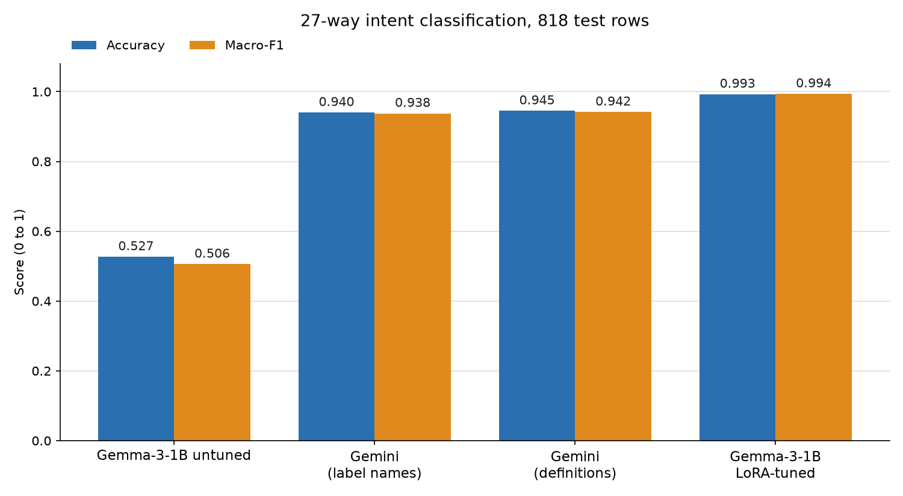

# H5 results: LoRA-tuned Gemma-3-1B vs untuned Gemini on 27-way intent classification

**Verdict: H5 supported: tuned Gemma accuracy 0.9927 exceeds both Gemini variants (0.9401, 0.9450).**

## Metrics

| Run | Accuracy | Macro-F1 | Confusable accuracy | Unparseable | n |
|---|---|---|---|---|---|
| Gemma-3-1B untuned | 0.5269 | 0.5057 | 0.4936 | 74 | 818 |
| Gemini (label names) | 0.9401 | 0.9377 | 0.9191 | 0 | 818 |
| Gemini (definitions) | 0.9450 | 0.9416 | 0.9277 | 0 | 818 |
| Gemma-3-1B LoRA-tuned | 0.9927 | 0.9936 | 0.9872 | 1 | 818 |

Unparseable outputs count as wrong in every metric.

## Paired comparison (tuned Gemma vs Gemini)

| Comparison | Only tuned right | Only Gemini right | McNemar p (exact, two-sided) |
|---|---|---|---|
| Tuned Gemma vs Gemini (label names) | 48 | 5 | 7.077e-10 |
| Tuned Gemma vs Gemini (definitions) | 43 | 4 | 2.781e-09 |

"Only tuned right" / "only Gemini right" count test rows where exactly one of the two is correct. The p-value is an exact binomial McNemar test on those discordant rows.

## Top-10 confusions: tuned Gemma

| True | Predicted | Count |
|---|---|---|
| get_invoice | check_invoice | 3 |
| delete_account | (unparseable) | 1 |
| set_up_shipping_address | change_shipping_address | 1 |
| track_order | delivery_period | 1 |

## Top-10 confusions: Gemini (definitions)

| True | Predicted | Count |
|---|---|---|
| create_account | registration_problems | 8 |
| cancel_order | check_cancellation_fee | 6 |
| set_up_shipping_address | change_shipping_address | 5 |
| track_order | delivery_period | 5 |
| get_invoice | check_invoice | 4 |
| create_account | switch_account | 3 |
| get_refund | check_refund_policy | 3 |
| change_shipping_address | edit_account | 2 |
| contact_customer_service | contact_human_agent | 2 |
| check_refund_policy | track_refund | 1 |

## Setup and caveats

- Gemini ran with its default reasoning ON, which was forced: OpenRouter returned a 400 error when reasoning was disabled for this model, although the spec asked for reasoning OFF. Reasoning gives Gemini extra inference-time compute that Gemma (no reasoning mode) lacks, so the comparison is not matched on compute; this favours Gemini, so the verdict is conservative on that axis.
- Gemma sees the full label list in its prompt, just like Gemini; tuning teaches the format and label boundaries, not the label set.
- The Gemini "definitions" variant uses label definitions written by us from the label names only (not from inspecting data or errors).
- The data is synthetic, templated Bitext utterances; high scores here may not transfer to real customer messages.
- The gain largely reflects learning this dataset's annotation conventions rather than general intent understanding. Gemini (definitions) top errors are create_account predicted as registration_problems (8), cancel_order as check_cancellation_fee (6) and set_up_shipping_address as change_shipping_address (5): label boundaries that are arbitrary without the dataset's conventions.
- Near-duplicate check (done once offline, not produced by report.py; test vs the 1k training subset): exact overlap is 0 between test and train (full train, 1k subset) and val200; 2 test rows match a training row exactly after normalising punctuation and case. Token-Jaccard similarity to the nearest training example: 9 test rows reach 1.0, 22 reach >=0.9, 103 (12.6%) reach >=0.8 and 300 (37%) reach >=0.7. Accuracy by similarity band (tuned Gemma vs Gemini-definitions): <0.5: 106 rows, 0.981 vs 0.906; 0.5-0.7: 412 rows, 0.993 vs 0.952; 0.7-0.8: 197 rows, 1.000 vs 0.944; >=0.8: 103 rows, 0.990 vs 0.961. The gap does not shrink on the least-similar rows, so near-duplicate leakage does not explain the result. However the data are templated and synthetic, so the absolute ~99% likely overstates performance on real customer messages.
- The test set has 818 rows, so one row is about 0.12 percentage points.
- Validation was a 200-row slice. It did separate the learning rates (step-500 scores 0.980, 0.985 and 1.000 for lr 5e-6, 1e-5 and 5e-5); only the choice of step within lr 5e-5 (step 500 at 1.000 vs 0.995 for steps 250 and 750) came down to a single row. The tuned model was run on the test set once.
- Training used only 1,000 examples (about 37 per label).
- Single seed, single run per condition: no estimate of run-to-run variance. The McNemar test covers test-row sampling only, not training or sampling randomness.
